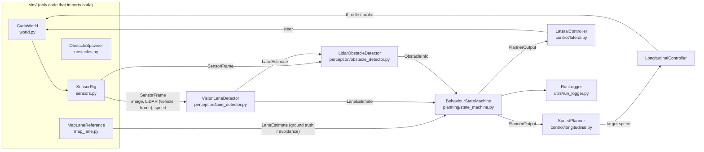
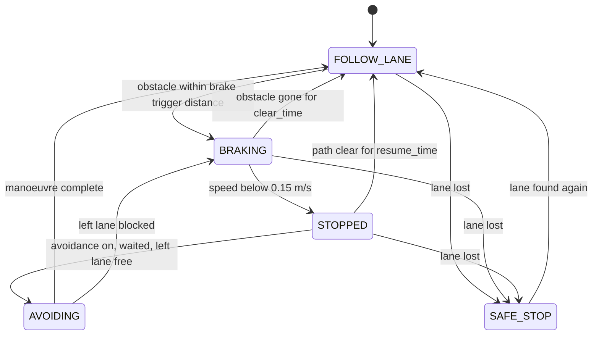

# Architecture (SCRUM-38)

## Data flow per tick (20 Hz, CARLA synchronous mode)



`lanebot/app.py` (`LaneBotApp.step`) runs exactly this chain once per tick.

## Interfaces (`lanebot/interfaces.py`)

| Type | Produced by | Consumed by | Key fields |
|---|---|---|---|
| `SensorFrame` | `SensorRig.tick()` | detectors, app | `image_bgr` (HxWx3), `lidar_xyz` (Nx3, vehicle frame), `vehicle.speed_mps`, `collisions` |
| `LaneEstimate` | `VisionLaneDetector.process()` / `MapLaneReference.estimate()` | obstacle detector, state machine, controllers | `valid`, `offset_m`, `heading_err_rad`, `curvature_1pm`, `lane_width_m`, `confidence`, `coeffs` |
| `ObstacleInfo` | `LidarObstacleDetector.detect()` | state machine | `detected`, `distance_m` (bumper gap), `lateral_m`, `num_points` |
| `PlannerOutput` | `BehaviourStateMachine.update()` | speed planner, lateral controller | `state`, `speed_cap_mps`, `target_offset_m`, `target_slope`, `target_curvature`, `use_map_lane`, `emergency_brake` |
| `ControlCommand` | controllers | `CarlaWorld.apply_control()` | `throttle`, `steer`, `brake` |

**Frame and sign conventions** (same as CARLA): vehicle frame x forward, **y right**, z up.
`offset_m > 0` = car is right of the lane centre; `heading_err_rad > 0` = car points right of the lane;
`curvature_1pm > 0` = road bends right; `steer > 0` = steer right. The lane centre in the vehicle frame is
`y(x) = c0 + c1·x + c2·x²`, so offset = −c0, heading error = −atan(c1), curvature = 2·c2/(1+c1²)^1.5.

Because vision and map estimators both output a `LaneEstimate`, `lane_detection.source: map` swaps in
ground-truth lanes without touching anything else: the quickest way to tell a perception bug from a
control bug.

## State machine



| State | Speed cap | Steering reference |
|---|---|---|
| FOLLOW_LANE | cruise, reduced by `approach_speed(d)` if an obstacle is seen | lane centre |
| BRAKING | `approach_speed(d)`; full brake if d < emergency distance | lane centre |
| STOPPED | 0 (holding brake) | lane centre |
| AVOIDING | `avoidance.speed_kmh` | original lane centre (map) + offset profile |
| SAFE_STOP | 0 | last lane estimate, steering decays to straight |

## Stopping distance (SCRUM-35)

`d_stop(v, a) = v·t_react + v²/(2a)`, t_react = 0.3 s

* brake trigger = `d_stop(v, 3.0 m/s²) + 3 m` (+1 m buffer in the state machine)
* emergency = `d_stop(v, 6.5 m/s²) + 1 m` -> full brake
* approach speed = the speed from which a 3 m/s² stop still ends 3 m before the obstacle

## Package layout

```
config/            default.yaml (all parameters), scenarios.yaml (tests)
lanebot/
  interfaces.py    shared data types
  app.py           main loop
  sim/             CARLA: world, sensors, obstacles, map lane reference
  perception/      lane_detector, obstacle_detector, camera_geometry
  planning/        state_machine, safety, avoidance
  control/         pid, lateral, longitudinal
  utils/           run_logger, debug_view
scripts/           command-line tools (one per ticket, see README)
tests/             unit tests + full loop against a fake CARLA
```
